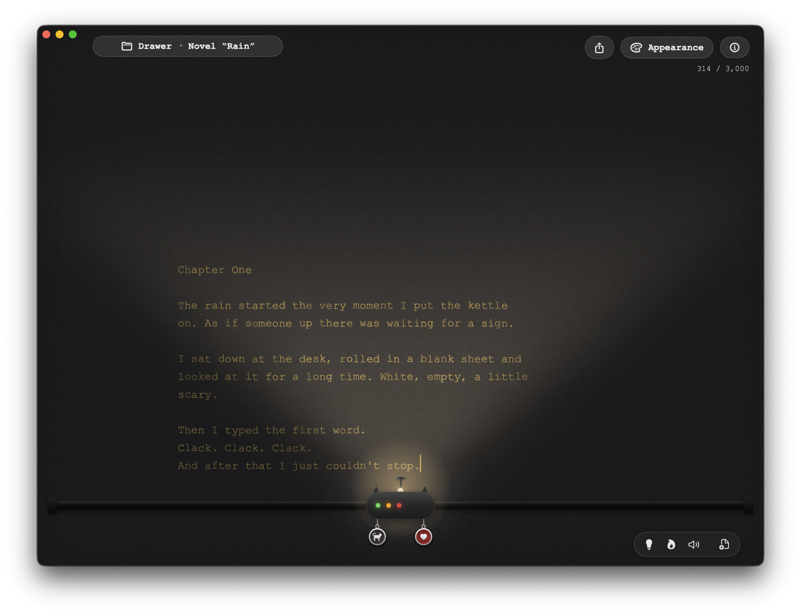
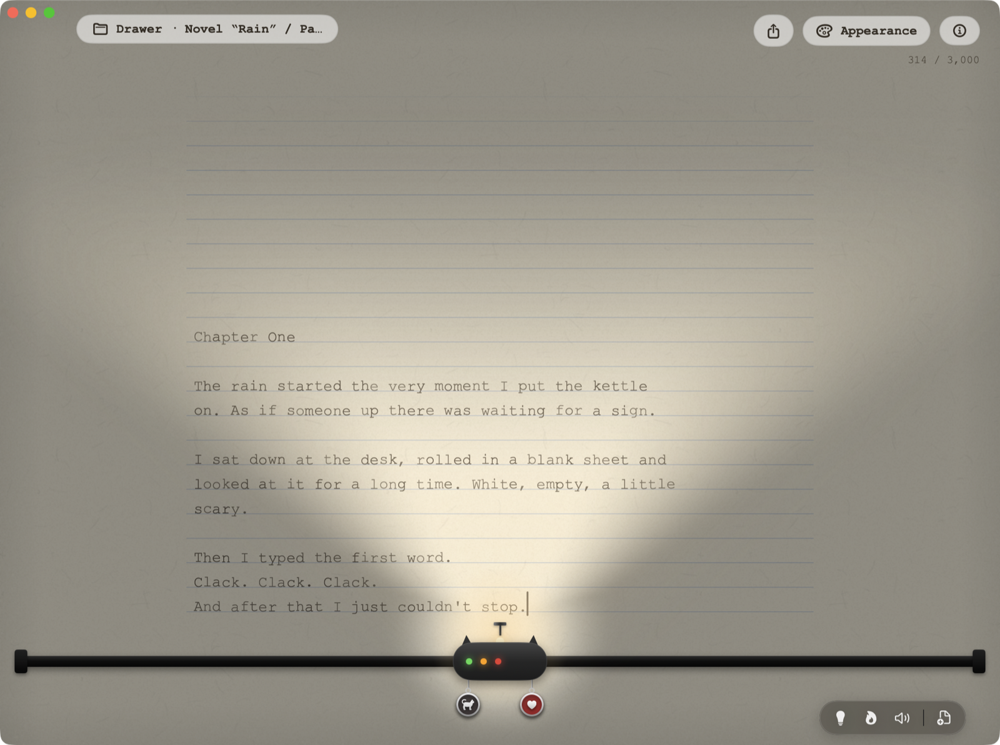
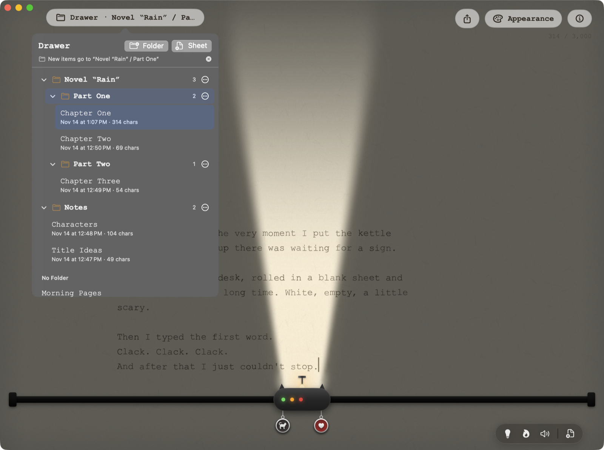
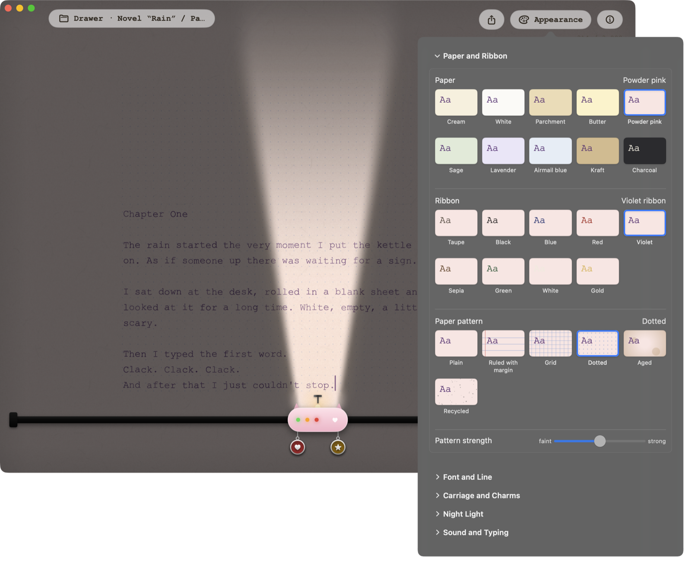
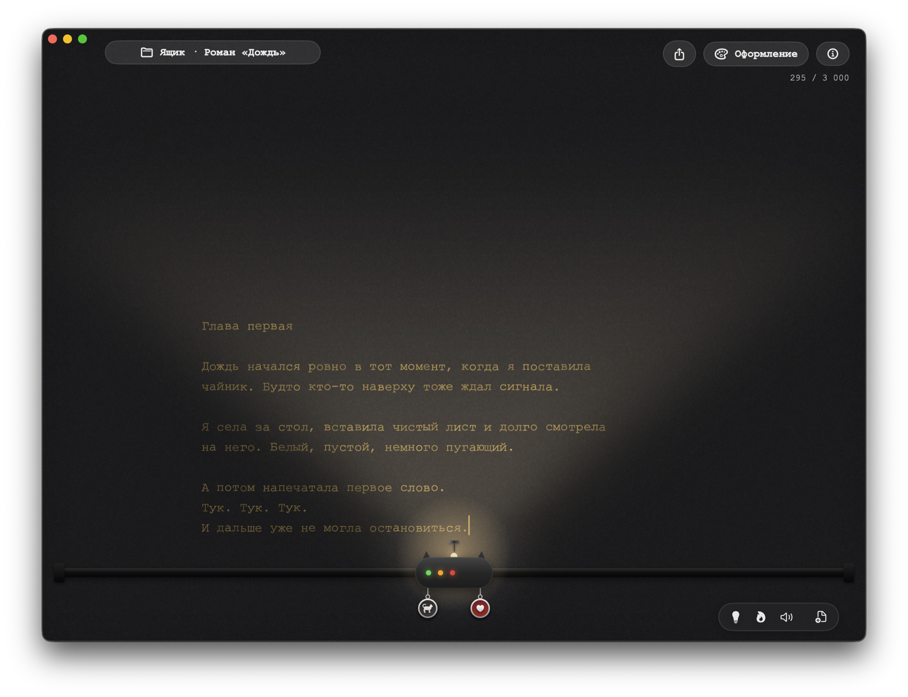
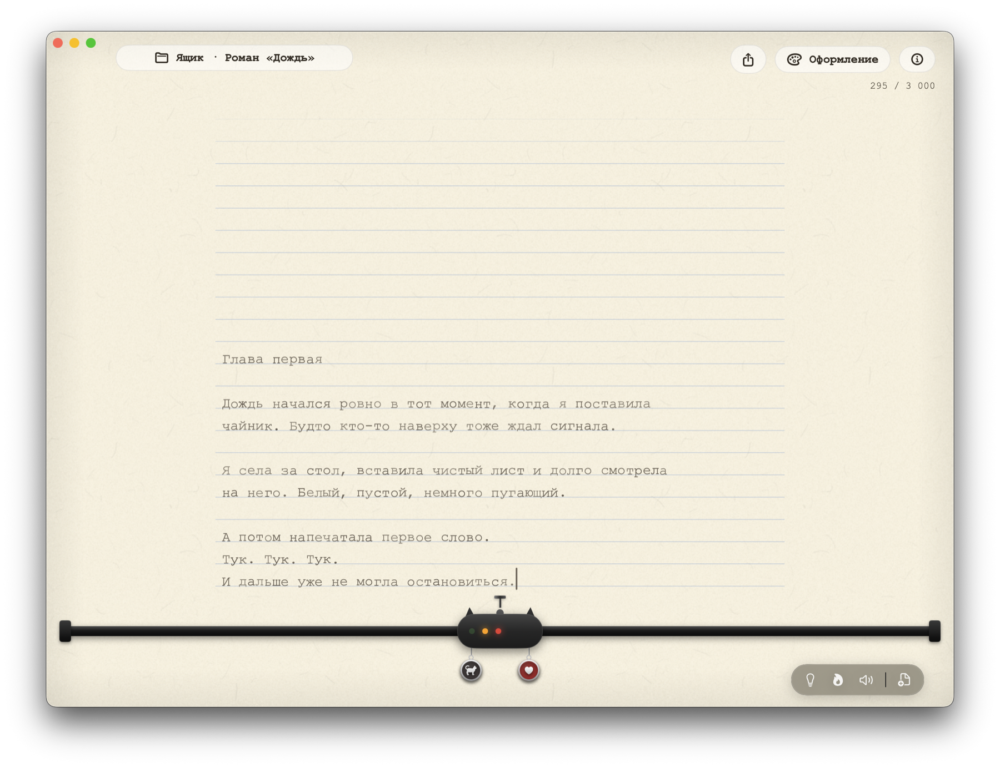
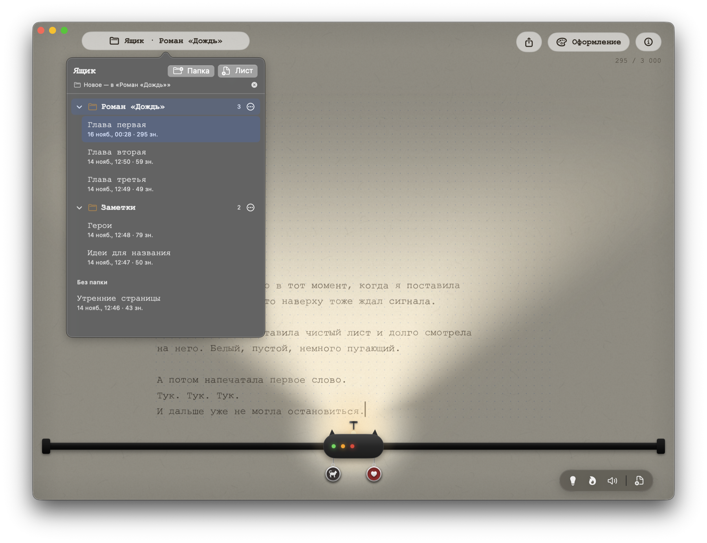

# Purrwriter

**English** · [Русский](#русский)

A typewriter for your Mac. Paper with visible fibers, slightly uneven letter strikes,
the sound of a real vintage typewriter, a bell at the end of the line and the warm glow of a lamp.

For novels, journals, morning pages and anything you want to write slowly and with pleasure.

### [⬇️ Download Purrwriter.dmg](https://github.com/vandaQ/purrwriter/releases/latest/download/Purrwriter.dmg)

macOS 14 Sonoma or later · free · English, German, French, Italian, Spanish and Russian



## Features

- **The sound of a real Erika 5 typewriter**, plus three more sound styles to choose from.
- **A bell at the end of the line** and a carriage return, just like on a real typewriter.
- **Night light**: a beam from the carriage or a desk lamp, for writing in the dark.
- **10 paper tones** (including a dark one), **9 ribbon colors** and patterns: ruled with margin, grid, dotted, aged, recycled.
- **8 carriages and charms** that swing when the carriage returns.
- **A drawer with folders** for your novels, chapters and notes.
- **Export** a sheet to PDF, Markdown or TXT. Printing, a Share button and a pretty card of your text for social media are built in.
- **Backups**: all sheets, folders and statistics in one file (File → Back Up All Sheets…), with gentle reminders.
- Your sheets are stored **only on your Mac** and never sent anywhere.
- **Six languages**: English, German, French, Italian, Spanish and Russian — switch in the **Purrwriter → Language** menu.

Want more? **Purrwriter Pro** is coming soon to the Mac App Store — [see what it adds](#purrwriter-pro).







## Installation

1. Download [Purrwriter.dmg](https://github.com/vandaQ/purrwriter/releases/latest/download/Purrwriter.dmg) and open it.
2. Drag Purrwriter into the Applications folder.
3. On first launch macOS will say it can't verify the developer. That's expected:
   the app isn't signed with a paid Apple certificate yet.
   Open **System Settings → Privacy & Security**,
   scroll down and click **“Open Anyway”**.

If the button isn't there, run this in Terminal:

```
xattr -dr com.apple.quarantine /Applications/Purrwriter.app
```

## Purrwriter Pro

**Coming soon to the Mac App Store.** Everything in the free version, plus tools for people who write a lot.
A one-time purchase — no subscription. Try every Pro feature free for 7 days first.
This free version on GitHub stays free.

| | Free | Pro |
|---|:---:|:---:|
| Typewriter sounds, bell, lamp and night light | ✓ | ✓ |
| Paper, ribbons, patterns, carriages and charms | ✓ | ✓ |
| The Drawer with folders | ✓ | ✓ |
| A sheet as PDF, TXT or Markdown, printing, Share | ✓ | ✓ |
| Card for social media | ✓ | ✓ |
| Backups and reminders | ✓ | ✓ |
| Six interface languages | ✓ | ✓ |
| Sheet length | 3,000 characters | 15,000 characters |
| Nested folders: parts, chapters and sections | | ✓ |
| Search across every sheet and folder | | ✓ |
| Daily word goal and timed sprints in full screen | | ✓ |
| Writing statistics: calendar, streaks, your best time to write | | ✓ |
| Forward Only: no erasing | | ✓ |
| Morning Pages | | ✓ |
| Save a sheet to Word or as an image | | ✓ |
| A whole folder at once: PDF, Word, TXT, Markdown, images, printing, Share | | ✓ |
| An ePub book from a folder of chapters | | ✓ |

**What's in Pro**

- **Forward Only.** Like a real typewriter, nothing can be erased: made a mistake — type “XXXX” and keep going. Your draft stops being polished forever and finally gets finished.
- **Daily goal and sprints.** Set a word goal for the day; the carriage bell rings when you reach it. Start a 15, 25 or 45-minute sprint — the window goes full screen, the Dock hides, and the bell rings at the end.
- **Statistics.** A calendar where every day is a tiny sheet of paper, day streaks, words this week and in total, and the time of day you write best.
- **Morning Pages.** About 750 words every morning, Julia Cameron's method: a fresh sheet for today in its own folder and a quiet note when you're done.
- **Search** across every sheet and folder, with the found words highlighted.
- **Long sheets** — 15,000 characters instead of 3,000: a whole chapter on one sheet.
- **Nested folders** — a novel with parts, chapters and scenes inside one another.
- **Export for real manuscripts.** Word (.docx) to send to an editor, sheets as images, a whole folder as one file, and an **ePub book** with a title page and table of contents, made from your folder of chapters.

### Updating from version 1.2

Just install the new version over the old one. On first launch your sheets move from the `Karetka` data folder to `Purrwriter` by themselves — nothing to do. The old app name «Каретка» is gone; you can delete `Каретка.app` after updating.

## Feedback and ideas

Found a bug or have an idea? Open an [issue](https://github.com/vandaQ/purrwriter/issues).

## Credits

- Erika 5 typewriter sounds are cut from the “WWS Typewriter” recording by Work With Sounds / Konrad Gutkowski, licensed under [CC BY 4.0](https://creativecommons.org/licenses/by/4.0/).
- End-of-line bell: “typewriter-ding-near-mono” by _stubb (freesound.org), CC0 1.0.

---

© 2026 Purrwriter. The app is free for personal use.
Copying, modifying, selling or redistributing the app without the author's written permission is prohibited.

---

## Русский

Печатная машинка для Mac. Бумага с волокнами, чуть неровные отпечатки литер,
звук настоящей старой машинки, звонок в конце строки и тёплый свет лампы.

Для книг, дневников, утренних страниц и всего, что хочется писать медленно и с удовольствием.

### [⬇️ Скачать Purrwriter.dmg](https://github.com/vandaQ/purrwriter/releases/latest/download/Purrwriter.dmg)

macOS 14 Sonoma или новее · бесплатно · русский, английский, немецкий, французский, итальянский и испанский



### Что умеет

- **Звук настоящей машинки Erika 5**, плюс ещё три характера звука на выбор.
- **Звонок в конце строки** и возврат каретки, как на настоящей машинке.
- **Ночной свет**: луч от каретки или настольная лампа, чтобы писать в темноте.
- **10 оттенков бумаги** (включая тёмную), **9 цветов ленты** и узоры: линейка с полями, клетка, точка, состаренная, эко-бумага.
- **8 кареток и подвески**, которые качаются при возврате каретки.
- **Ящик с папками** для романов, глав и заметок.
- **Экспорт** листа в PDF, Markdown и TXT. Есть печать, кнопка «Поделиться» и красивая карточка с текстом для соцсетей.
- **Резервные копии**: все листы, папки и статистика в одном файле (Файл → Сохранить резервную копию…) и напоминания о них.
- Листы хранятся **только на вашем Mac** и никуда не отправляются.
- **Шесть языков**: русский, английский, немецкий, французский, итальянский и испанский — переключаются в меню **Purrwriter → Язык**.

Хочется больше? Скоро в Mac App Store — **Purrwriter Pro**: [что в нём есть](#purrwriter-pro-1).






### Установка

1. Скачайте [Purrwriter.dmg](https://github.com/vandaQ/purrwriter/releases/latest/download/Purrwriter.dmg) и откройте его.
2. Перетащите Purrwriter в папку «Программы».
3. При первом запуске macOS скажет, что не может проверить разработчика. Это нормально:
   программа пока не подписана платным сертификатом Apple.
   Откройте **Системные настройки → Конфиденциальность и безопасность**,
   пролистайте вниз и нажмите **«Всё равно открыть»**.

Если кнопки нет, можно выполнить в Терминале:

```
xattr -dr com.apple.quarantine /Applications/Purrwriter.app
```

### Purrwriter Pro

**Скоро в Mac App Store.** Всё, что есть в бесплатной версии, и инструменты для тех, кто пишет много.
Одна покупка навсегда — без подписки. Сначала все функции Pro можно попробовать бесплатно 7 дней.
Бесплатная версия на GitHub остаётся бесплатной.

| | Бесплатно | Pro |
|---|:---:|:---:|
| Звуки машинки, звонок, лампа и ночной свет | ✓ | ✓ |
| Бумага, ленты, узоры, каретки и подвески | ✓ | ✓ |
| «Ящик» с папками | ✓ | ✓ |
| Лист в PDF, TXT или Markdown, печать, «Поделиться» | ✓ | ✓ |
| Карточка для соцсетей | ✓ | ✓ |
| Резервные копии и напоминания | ✓ | ✓ |
| Шесть языков интерфейса | ✓ | ✓ |
| Длина листа | 3000 знаков | 15 000 знаков |
| Вложенные папки: части, главы и разделы | | ✓ |
| Поиск по всем листам и папкам | | ✓ |
| Цель на день и спринты с таймером на весь экран | | ✓ |
| Статистика: календарь, серии дней, лучшее время для письма | | ✓ |
| «Только вперёд»: стереть нельзя | | ✓ |
| Утренние страницы | | ✓ |
| Лист в Word или картинкой | | ✓ |
| Целая папка сразу: PDF, Word, TXT, Markdown, картинки, печать, «Поделиться» | | ✓ |
| Книга ePub из папки с главами | | ✓ |

**Что даёт Pro**

- **«Только вперёд».** Как на настоящей машинке, стереть ничего нельзя: ошиблись — напечатайте «XXXX» и пишите дальше. Черновик перестаёт бесконечно править себя и наконец дописывается.
- **Цель на день и спринты.** Задайте цель в словах — когда она выполнена, звенит колокольчик каретки. Спринт на 15, 25 или 45 минут: окно на весь экран, Dock прячется, в конце звонок.
- **Статистика.** Календарь, где каждый день — маленький лист бумаги, серии дней подряд, слова за неделю и за всё время и время суток, когда вам пишется лучше всего.
- **Утренние страницы.** Около 750 слов каждое утро по методу Джулии Кэмерон: свежий лист на сегодня в отдельной папке и тихое сообщение, когда страницы написаны.
- **Поиск** по всем листам и папкам, найденные слова подсвечены.
- **Длинные листы** — 15 000 знаков вместо 3000: целая глава на одном листе.
- **Вложенные папки** — роман с частями, главами и сценами внутри друг друга.
- **Экспорт для настоящих рукописей.** Word (.docx), чтобы отправить редактору, листы картинками, целая папка одним файлом и **книга ePub** с титулом и оглавлением из папки с главами.

### Обновление с версии 1.2

Просто установите новую версию поверх старой. При первом запуске листы сами переедут из папки данных `Karetka` в `Purrwriter` — ничего делать не нужно. Старое имя «Каретка» больше не используется: после обновления `Каретка.app` можно удалить.

### Отзывы и идеи

Нашли ошибку или есть идея? Напишите в [Issues](https://github.com/vandaQ/purrwriter/issues).

### Благодарности

- Звуки машинки Erika 5 нарезаны из записи «WWS Typewriter»: Work With Sounds / Konrad Gutkowski, лицензия [CC BY 4.0](https://creativecommons.org/licenses/by/4.0/).
- Звонок конца строки: «typewriter-ding-near-mono», _stubb (freesound.org), CC0 1.0.

---

© 2026 Purrwriter. Программа распространяется бесплатно для личного использования.
Копирование, изменение, продажа и распространение программы без письменного разрешения автора запрещены.
