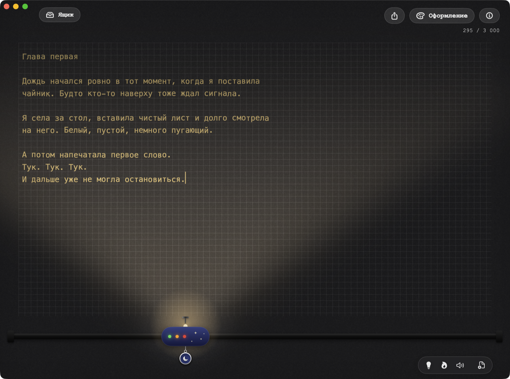
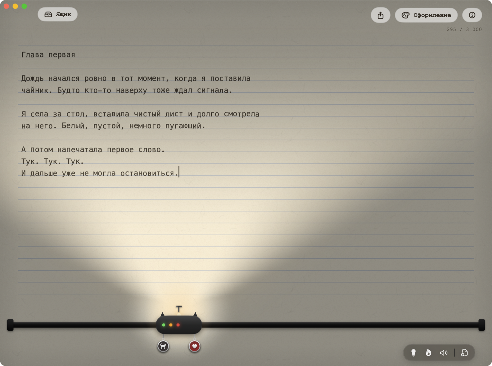
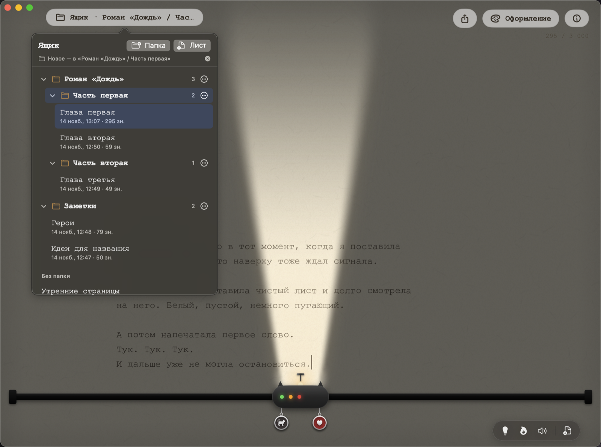

# Purrwriter

Печатная машинка для Mac. Бумага с волокнами, чуть неровные отпечатки литер,
звук настоящей старой машинки, звонок в конце строки и тёплый свет лампы.

Для книг, дневников, утренних страниц и всего, что хочется писать медленно и с удовольствием.

### [⬇️ Скачать Purrwriter.dmg](https://github.com/vandaQ/purrwriter/releases/latest/download/Purrwriter.dmg)

macOS 14 Sonoma или новее · бесплатно



## Что умеет

- **Звук настоящей машинки Erika 5**, плюс ещё три характера звука на выбор.
- **Звонок в конце строки** и возврат каретки, как на настоящей машинке.
- **Режим «как настоящая машинка»**: Delete не стирает букву, а оставляет её на листе.
- **Ночной свет**: луч от каретки или настольная лампа, чтобы писать в темноте.
- **10 оттенков бумаги** (включая тёмную), **9 цветов ленты** и узоры: линейка с полями, клетка, точка, состаренная, эко-бумага.
- **8 кареток и подвески**, которые качаются при возврате каретки.
- **Ящик с папками**: роман можно разложить по частям и главам.
- **Экспорт** листа или целой папки в PDF, Word (.docx), Markdown, TXT и картинки. Есть печать и кнопка «Поделиться».
- Листы хранятся **только на вашем Mac** и никуда не отправляются.






## Установка

1. Скачайте [Purrwriter.dmg](https://github.com/vandaQ/purrwriter/releases/latest/download/Purrwriter.dmg) и откройте его.
2. Перетащите Purrwriter в папку «Программы».
3. При первом запуске macOS скажет, что не может проверить разработчика. Это нормально:
   программа пока не подписана платным сертификатом Apple.
   Откройте **Системные настройки → Конфиденциальность и безопасность**,
   пролистайте вниз и нажмите **«Всё равно открыть»**.

Если кнопки нет, можно выполнить в Терминале:

```
xattr -dr com.apple.quarantine /Applications/Purrwriter.app
```

## Отзывы и идеи

Нашли ошибку или есть идея? Напишите в [Issues](https://github.com/vandaQ/purrwriter/issues).

## Благодарности

- Звуки машинки Erika 5 нарезаны из записи «WWS Typewriter»: Work With Sounds / Konrad Gutkowski, лицензия [CC BY 4.0](https://creativecommons.org/licenses/by/4.0/).
- Звонок конца строки: «typewriter-ding-near-mono», _stubb (freesound.org), CC0 1.0.

---

© 2026 Purrwriter. Программа распространяется бесплатно для личного использования.
Копирование, изменение, продажа и распространение программы без письменного разрешения автора запрещены.
