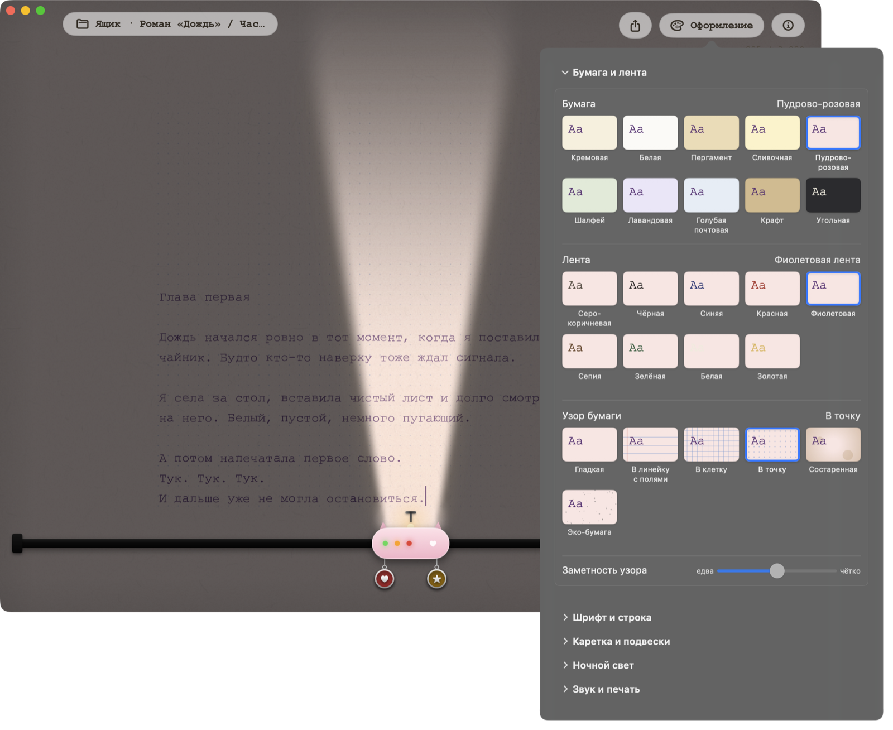

# Purrwriter

**English** · [Русский](#русский)

A typewriter for your Mac. Paper with visible fibers, slightly uneven letter strikes,
the sound of a real vintage typewriter, a bell at the end of the line and the warm glow of a lamp.

For novels, journals, morning pages and anything you want to write slowly and with pleasure.

### [⬇️ Download Purrwriter.dmg](https://github.com/vandaQ/purrwriter/releases/latest/download/Purrwriter.dmg)

macOS 14 Sonoma or later · free · English and Russian


## Features

- **The sound of a real Erika 5 typewriter**, plus three more sound styles to choose from.
- **A bell at the end of the line** and a carriage return, just like on a real typewriter.
- **“Real typewriter” mode**: Delete doesn't erase a letter, it stays on the sheet.
- **Night light**: a beam from the carriage or a desk lamp, for writing in the dark.
- **10 paper tones** (including a dark one), **9 ribbon colors** and patterns: ruled with margin, grid, dotted, aged, recycled.
- **8 carriages and charms** that swing when the carriage returns.
- **A drawer with folders**: split your novel into parts and chapters.
- **Export** a sheet to PDF, Markdown or TXT. Printing and a Share button are built in.
- Your sheets are stored **only on your Mac** and never sent anywhere.
- **Interface language**: English or Russian, switch it in the **Purrwriter → Language** menu.


## Installation

1. Download [Purrwriter.dmg](https://github.com/vandaQ/purrwriter/releases/latest/download/Purrwriter.dmg) and open it.
2. Drag Purrwriter into the Applications folder.
3. On first launch macOS will say it can't verify the developer. That's expected:
   the app isn't signed with a paid Apple certificate yet.
   Open **System Settings → Privacy & Security**,
   scroll down and click **“Open Anyway”**.

If the button isn't there, run this in Terminal:

```
xattr -dr com.apple.quarantine /Applications/Purrwriter.app
```

## Feedback and ideas

Found a bug or have an idea? Open an [issue](https://github.com/vandaQ/purrwriter/issues).

## Credits

- Erika 5 typewriter sounds are cut from the “WWS Typewriter” recording by Work With Sounds / Konrad Gutkowski, licensed under [CC BY 4.0](https://creativecommons.org/licenses/by/4.0/).
- End-of-line bell: “typewriter-ding-near-mono” by _stubb (freesound.org), CC0 1.0.

---

© 2026 Purrwriter. The app is free for personal use.
Copying, modifying, selling or redistributing the app without the author's written permission is prohibited.

---

## Русский

Печатная машинка для Mac. Бумага с волокнами, чуть неровные отпечатки литер,
звук настоящей старой машинки, звонок в конце строки и тёплый свет лампы.

Для книг, дневников, утренних страниц и всего, что хочется писать медленно и с удовольствием.

### [⬇️ Скачать Purrwriter.dmg](https://github.com/vandaQ/purrwriter/releases/latest/download/Purrwriter.dmg)

macOS 14 Sonoma или новее · бесплатно · русский и английский


### Что умеет

- **Звук настоящей машинки Erika 5**, плюс ещё три характера звука на выбор.
- **Звонок в конце строки** и возврат каретки, как на настоящей машинке.
- **Режим «как настоящая машинка»**: Delete не стирает букву, а оставляет её на листе.
- **Ночной свет**: луч от каретки или настольная лампа, чтобы писать в темноте.
- **10 оттенков бумаги** (включая тёмную), **9 цветов ленты** и узоры: линейка с полями, клетка, точка, состаренная, эко-бумага.
- **8 кареток и подвески**, которые качаются при возврате каретки.
- **Ящик с папками**: роман можно разложить по частям и главам.
- **Экспорт** листа в PDF, Markdown и TXT. Есть печать и кнопка «Поделиться».
- Листы хранятся **только на вашем Mac** и никуда не отправляются.
- **Язык интерфейса**: русский или английский, переключается в меню **Purrwriter → Язык**.




### Установка

1. Скачайте [Purrwriter.dmg](https://github.com/vandaQ/purrwriter/releases/latest/download/Purrwriter.dmg) и откройте его.
2. Перетащите Purrwriter в папку «Программы».
3. При первом запуске macOS скажет, что не может проверить разработчика. Это нормально:
   программа пока не подписана платным сертификатом Apple.
   Откройте **Системные настройки → Конфиденциальность и безопасность**,
   пролистайте вниз и нажмите **«Всё равно открыть»**.

Если кнопки нет, можно выполнить в Терминале:

```
xattr -dr com.apple.quarantine /Applications/Purrwriter.app
```

### Отзывы и идеи

Нашли ошибку или есть идея? Напишите в [Issues](https://github.com/vandaQ/purrwriter/issues).

### Благодарности

- Звуки машинки Erika 5 нарезаны из записи «WWS Typewriter»: Work With Sounds / Konrad Gutkowski, лицензия [CC BY 4.0](https://creativecommons.org/licenses/by/4.0/).
- Звонок конца строки: «typewriter-ding-near-mono», _stubb (freesound.org), CC0 1.0.

---

© 2026 Purrwriter. Программа распространяется бесплатно для личного использования.
Копирование, изменение, продажа и распространение программы без письменного разрешения автора запрещены.
